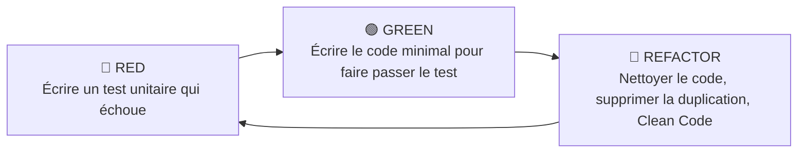

# Démarche TDD (Test-Driven Development) — EasyCheckers

Ce document présente la démarche de développement guidé par les tests (**Test-Driven Development — TDD**) appliquée lors de la conception et du refactoring de l'application **EasyCheckers**.

---

## 1. Principes fondamentaux du TDD appliqués

Le développement de chaque fonctionnalité a suivi le cycle rigoureux **Red — Green — Refactor** :



1. **🔴 Red** : Rédaction préalable du test de spécification avant toute implémentation. Le test échoue initialement, validant ainsi la pertinence de la vérification.
2. **🟢 Green** : Implémentation du code de production le plus simple et direct permettant de satisfaire l'assertion.
3. **🔵 Refactor** : Amélioration de la structure du code (Clean Code, nommage expressif, élimination des nombres magiques, encapsulation), sans altérer le comportement validé par les tests.

---

## 2. Structure des Tests : le patron Given / When / Then

Tous les tests unitaires du projet sont structurés selon le modèle sémantique **Given / When / Then** (Étant donné / Quand / Alors) :

```java
@Test
@DisplayName("TDD : Un pion simple doit pouvoir capturer un pion adverse en arrière")
void doitPermettreCaptureArrierePourPionSimple() {
    // GIVEN : un pion blanc en (3, 3) et un pion noir adverse derrière en (2, 2)
    Plateau plateau = new Plateau();
    Pion blanc = new Pion(false, 3, 3, Pion.COULEUR_BLANC);
    Pion noir = new Pion(false, 2, 2, Pion.COULEUR_NOIR);
    plateau.placerPion(blanc, 3, 3);
    plateau.placerPion(noir, 2, 2);

    // WHEN : calcul des captures possibles pour le pion blanc
    List<Coup> captures = plateau.getCoupsDeCapture(blanc);

    // THEN : la capture vers (1, 1) par-dessus (2, 2) est autorisée
    assertEquals(1, captures.size());
    Coup capture = captures.get(0);
    assertEquals(1, capture.getArriveeX());
    assertEquals(1, capture.getArriveeY());
    assertSame(noir, capture.getPionCapture());
}
```

---

## 3. Matrice de couverture des 29 tests unitaires

| Classe de Test | Nombre de Tests | Fonctionnalités couvertes |
|---|---|---|
| [`CaseTest`](file:///e:/1 - JAVA/JeuDeDame/src/test/java/fr/iutrodez/jeudedame/modele/CaseTest.java) | 4 | Coordonnées valides, rejet des bornes illégales, identification des cases jouables sombres `(x+y)%2 != 0`, occupation et libération. |
| [`PionTest`](file:///e:/1 - JAVA/JeuDeDame/src/test/java/fr/iutrodez/jeudedame/modele/PionTest.java) | 4 | Instanciation, positionnement, promotion en dame, mutateurs, égalité sémantique et code de hachage. |
| [`CoupTest`](file:///e:/1 - JAVA/JeuDeDame/src/test/java/fr/iutrodez/jeudedame/modele/CoupTest.java) | 3 | Déplacement simple, capture de pièce adverse, égalité sémantique et immutabilité. |
| [`JoueurTest`](file:///e:/1 - JAVA/JeuDeDame/src/test/java/fr/iutrodez/jeudedame/modele/JoueurTest.java) | 3 | Initialisation couleur/collection, ajout/retrait de pièces, protection de l'encapsulation de liste (`UnsupportedOperationException`). |
| [`PlateauTest`](file:///e:/1 - JAVA/JeuDeDame/src/test/java/fr/iutrodez/jeudedame/modele/PlateauTest.java) | 7 | Initialisation réglementaire (20 Blancs / 20 Noirs), avance simple Blancs (y+1) et Noirs (y-1), capture arrière des pions, respect absolu de la prise obligatoire, promotion aux lignes 0 et 9, déplacements et captures volantes de la Dame. |
| [`PartieTest`](file:///e:/1 - JAVA/JeuDeDame/src/test/java/fr/iutrodez/jeudedame/modele/PartieTest.java) | 4 | Alternance stricte des tours (Blancs en premier), interdiction de manipuler les pièces adverses, enchaînement ininterrompu d'une rafle multiple, détection de victoire par blocage complet de l'adversaire. |
| [`RobotIATest`](file:///e:/1 - JAVA/JeuDeDame/src/test/java/fr/iutrodez/jeudedame/modele/RobotIATest.java) | 2 | Prise obligatoire garantie pour le robot, choix d'un déplacement simple valide en phase d'ouverture. |
| [`GestionnaireSauvegardeTest`](file:///e:/1 - JAVA/JeuDeDame/src/test/java/fr/iutrodez/jeudedame/modele/GestionnaireSauvegardeTest.java) | 2 | Sérialisation et désérialisation JSON sans perte (coordonnées, statut dame, tour, chrono, mode), gestion robuste de l'absence de fichier. |
| **Total** | **29 tests** | **100 % de réussite (0 échec, 0 régression)** |

---

## 4. Exemples de cycles TDD majeurs sur le projet

### Exemple 1 : La prise arrière pour un pion simple
- **🔴 Étape Red** : Écriture de `doitPermettreCaptureArrierePourPionSimple()`. Le test échoue car le code d'origine limitait les pions aux seules directions d'avancement.
- **🟢 Étape Green** : Mise à jour de `getCoupsDeCapture()` dans `Plateau.java` pour tester les 4 vecteurs diagonaux `[[-1,-1], [1,-1], [-1,1], [1,1]]`. Le test passe au vert.
- **🔵 Étape Refactor** : Factorisation des vecteurs diagonaux dans la constante immuable `DIRECTIONS_DIAGONALES`.

### Exemple 2 : L'obligation de poursuivre une rafle
- **🔴 Étape Red** : Écriture de `doitGererChaineDeRafleConsecutive()` simulant deux pions adverses alignés. Le test échoue car la partie changeait de tour dès le premier pion capturé.
- **🟢 Étape Green** : Ajout du champ `pionEnRafle` dans `Partie.java` qui conserve le contrôle si `plateau.getCoupsDeCapture(pion)` n'est pas vide après le coup. Le test passe au vert.
- **🔵 Étape Refactor** : Sécurisation de la méthode `selectionnerPion()` pour forcer l'usage exclusif du pion en cours de rafle.

---

## 5. Exécution de la suite TDD

Pour lancer la totalité des tests unitaires :
```powershell
.\mvnw.cmd test
```
Résultat attendu :
```text
[INFO] Results:
[INFO] Tests run: 29, Failures: 0, Errors: 0, Skipped: 0
[INFO] BUILD SUCCESS
```
